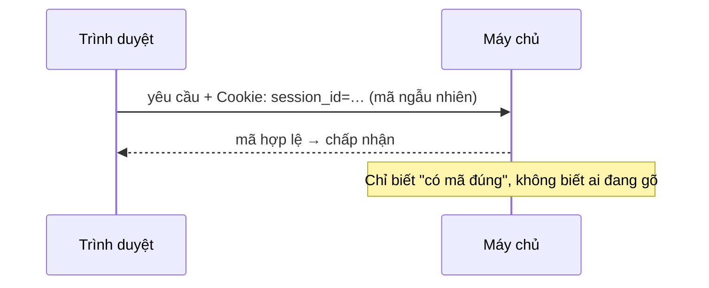
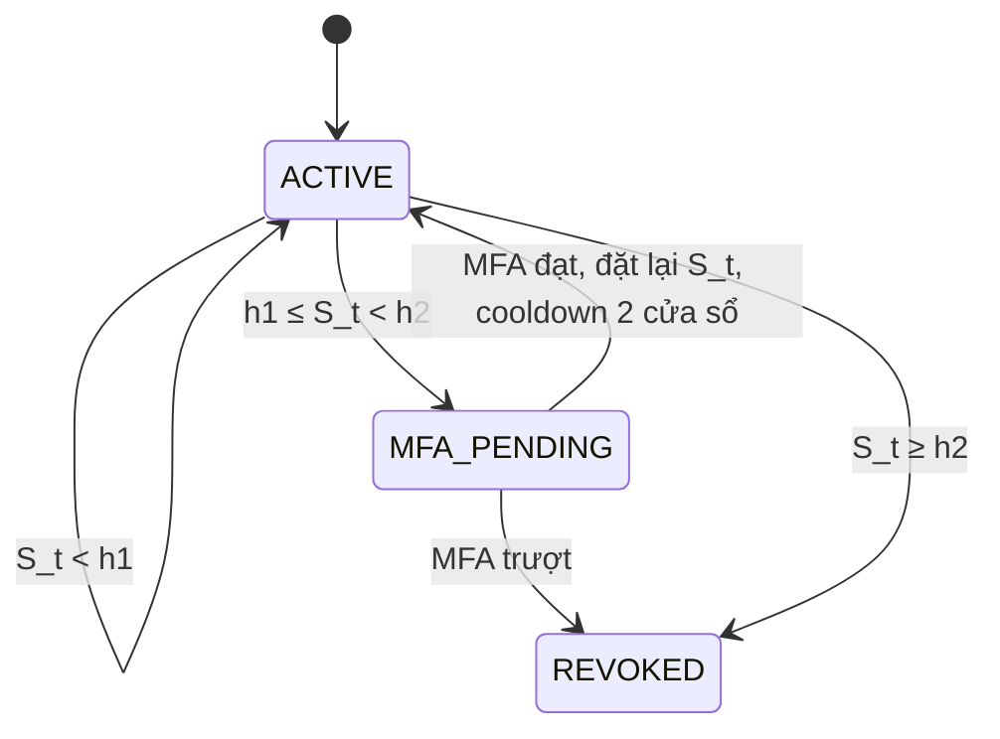

# Đặc tả thiết kế Slidev: "Xác thực liên tục thích ứng dựa trên nhịp gõ phím"

Giả định hạn 15 phút, 23 slide (đã bỏ 6 slide chia mục, thay bằng thẻ mục nhỏ ở góc trái trên). Số trong ngoặc "cũ N" là số slide của file pptx hiện tại.

## 0. Quy ước chung

**Nguyên tắc nội dung**
- Mỗi slide tối đa 5 dòng chữ chính; mỗi slide một thông điệp, đặt làm tiêu đề dạng câu khẳng định.
- Mọi số liệu lấy từ báo cáo v2 (Bảng 13–16) và `macro_policy_metrics.csv`. Không thêm số mới.
- **Không đưa lên slide** bất kỳ câu nào nói về việc ai đó góp ý. Các thẻ `[ý 1]…[ý 5]` ở dưới chỉ để bạn đối chiếu; xóa khi dựng.

**Thiết kế (giữ palette bộ cũ cho đồng nhất)**
- Nền `#F8FAFC`, chữ `#0F172A`, xám phụ `#64748B`.
- Xanh dương `#2563EB` = thông tin chính; xanh lá `#059669` = đã hiện thực/an toàn; đỏ `#E11D48` = rủi ro/chưa làm; cam `#D97706` = cảnh báo, MFA.
- Font Roboto hoặc Inter. Chữ nội dung ≥ 22 px, chú thích ≥ 16 px.

**Kỹ thuật Slidev**
- Diagram: khối ```` ```mermaid ````. Công thức: KaTeX `$$…$$`. Biểu đồ: component Vue (Chart.js hoặc ECharts) hoặc SVG viết tay, dữ liệu cho sẵn bên dưới.
- Hiệu ứng: `<v-clicks>` hoặc `v-click`; mỗi slide tối đa 3 lần click.
- Lời nói: đặt trong khối `<!-- … -->` cuối slide (presenter notes).
- Hình có sẵn (trích từ báo cáo v2): `H1_timeline_khoang_ho.png`, `H2_dinh_nghia_tu_du_lieu_den_quyet_dinh.png`, `H3_kien_truc_muc_tieu_va_hien_thuc.png`, `H4_may_trang_thai.png`. Đặt trong `public/img/`.

**Prompt mẫu cho AI local (mỗi slide một lần)**
> Bạn viết Slidev (markdown). Dùng đúng văn bản "Hiển thị" và "Hình" của slide S{n} trong đặc tả; không thêm số liệu, không thêm khẳng định. Layout: {layout}. Mỗi mục trong "Hiển thị" là một dòng; dùng `v-click` theo "Hiệu ứng". Đưa "Script" vào presenter notes. Chỉ trả về markdown của slide.

**Bảng đối chiếu nội bộ (không render)**

| Ý cần đáp ứng | Slide |
|---|---|
| [ý 1] Định nghĩa lý thuyết có hình, ứng dụng thực tế, biện pháp thay thế, vì sao chọn nhịp gõ, ưu/nhược lớn nhất | S4, S5 |
| [ý 2] Công trình mới, phân loại, đặc trưng, trường phái, đánh giá | S6, S10 |
| [ý 3] Cookie chứa gì | S3 |
| [ý 4] Công thức/tham số lấy từ đâu | S11, S13 |
| [ý 5] Viết tắt có giải thích | S3, S7, S10, S11, S15, S16 (giải thích ở lần đầu) |

---

## S1. Trang bìa (cũ 1)
- **Sửa:** thêm dòng phụ nhỏ "Kết quả trên dữ liệu mô phỏng". Giữ tên giảng viên, nhóm, ngày.
- **Layout:** `cover`.
- **Script (15 giây):** "Chúng em trình bày đề tài xác thực liên tục dựa trên nhịp gõ phím. Phần kết quả hiện chạy trên dữ liệu mô phỏng và chúng em sẽ nói rõ điều đó ở từng chỗ."

## S2. Mục lục (cũ 2)
- **Sửa:** còn 5 mục: 1 Bối cảnh, bài toán, nghiên cứu liên quan · 2 Phương pháp và kiến trúc · 3 Thực nghiệm và kết quả · 4 Demo · 5 Giới hạn và kết luận. Bỏ mục "Tài liệu tham khảo".
- **Script (5 giây):** một câu nêu thứ tự.

## S3. Sau khi qua MFA, máy chủ chỉ thấy một mã phiên (cũ 4, sửa)
- **Layout:** trên là timeline, dưới là 3 thẻ ngang.
- **Hiển thị:**
  - Dòng phụ: "MFA (Multi-Factor Authentication, xác thực đa yếu tố) chỉ kiểm tra lúc đăng nhập."
  - Hình trên: `H1_timeline_khoang_ho.png`.
  - Thẻ 1 **Cookie phiên:** "Thường chỉ là mã định danh ngẫu nhiên; không chứa nhịp gõ. Secure/HttpOnly/SameSite là thuộc tính cấu hình cookie, không phải dữ liệu hành vi."
  - Thẻ 2 **NIST SP 800-63B-4 (2025):** "Giám sát phiên là biện pháp tùy chọn; xác thực lại định kỳ mới là yêu cầu bắt buộc. Tín hiệu có thể gồm nhịp gõ."
  - Thẻ 3 **Khi nghi vấn:** "Hỏi lại MFA hoặc thu hồi phiên."
- **Diagram nhỏ trong thẻ 1 (Mermaid):**

- **Hiệu ứng:** click 1 hiện thẻ cookie (kèm diagram), click 2 hiện NIST và "khi nghi vấn".
- **Script (60 giây):** "9 giờ người dùng đăng nhập và qua MFA. 13 giờ 20 người khác ngồi vào máy đang mở. Máy chủ chỉ kiểm tra cookie, mà cookie là mã ngẫu nhiên, nên nó không biết ai đang gõ. NIST coi giám sát phiên là biện pháp tùy chọn, còn xác thực lại định kỳ mới bắt buộc. Khoảng hở này là điều đề tài muốn rút ngắn."
- **Nguồn cần mở lại:** OWASP Session Management Cheat Sheet (mình chưa mở trang gốc).

## S4. Xác thực liên tục là gì, và ngoài thực tế ai đang dùng? (mới)
- **Layout:** `two-cols`. Trái hình, phải chữ.
- **Hình trái:** `H2_dinh_nghia_tu_du_lieu_den_quyet_dinh.png` (nhịp gõ → đặc trưng → điểm → tích lũy → quyết định).
- **Hiển thị phải:**
  - "Đánh giá liên tục tín hiệu trong phiên → tiếp tục / hỏi MFA / thu hồi phiên."
  - "Là xác minh **1:1** ('đúng chủ không?'), không phải nhận dạng 'đây là ai'."
  - Thẻ **TypingDNA ActiveLock:** "Chạy trên máy Windows/macOS, theo dõi cách gõ (có thể thêm chuột, khuôn mặt), khóa máy hoặc cảnh báo ngầm."
  - Chú thích nhỏ: "Thông tin từ nhà cung cấp, không tương đương hệ thống nhóm (chỉ nhịp gõ; mô phỏng offline phiên đã qua MFA)."
- **Tùy chọn (chip nhỏ):** "Hãng nêu: lớp kiểm tra ngắn khoảng 50 ký tự; kiểm tra sâu 150–200 ký tự. Số của hãng, không so trực tiếp với TTD của nhóm." Mình đã xác nhận các điểm Windows/macOS, chạy trên thiết bị, chuột và khuôn mặt tùy chọn ở trang của hãng.
- **Hiệu ứng:** click 1 hiện ActiveLock.
- **Script (60 giây):** "Xác thực liên tục là kiểm tra thêm tín hiệu ngay trong phiên, thay vì chỉ lúc đăng nhập. Đây là xác minh một-một, không nhận dạng người dùng. Ngoài thực tế đã có sản phẩm như ActiveLock, nhưng đó là mô tả của nhà cung cấp, và hệ thống đó còn dùng thêm tín hiệu khác, nên không tương đương hệ thống của nhóm."

## S5. Vì sao chọn nhịp gõ: so với các biện pháp khác (cũ 5, sửa)
- **Layout:** trái bảng, phải 3 thẻ.
- **Bảng (2 cột chữ, tô nổi hàng cuối):**

| Biện pháp | Ưu điểm | Giới hạn |
|---|---|---|
| Timeout phiên | Giới hạn thời gian phiên | Kẻ lạ tiếp tục thao tác vẫn giữ phiên |
| Xác thực lại định kỳ | Điểm kiểm tra rõ | Gây gián đoạn; còn khoảng hở giữa hai lần |
| IP, thiết bị | Thêm tín hiệu rủi ro | Dùng ngay máy đang mở thì tín hiệu có thể không đổi |
| **Nhịp gõ** | Thu thụ động bằng bàn phím sẵn có | Cần đủ lượng phím; không gõ thì không có bằng chứng |

- **3 thẻ phải:**
  - Xanh dương: "Mỗi người gõ một kiểu (136 triệu lần nhấn phím của 168.000 người, Dhakal 2018)."
  - Xanh lá: "**Ưu điểm lớn nhất:** thu thụ động, không cần phần cứng, có bằng chứng ngay khi gõ."
  - Đỏ: "**Nhược điểm lớn nhất:** không gõ thì không có bằng chứng → lớp bổ sung, không thay MFA."
- **Hiệu ứng:** hàng bảng hiện lần lượt; click cuối hiện hai thẻ ưu/nhược.
- **Script (45 giây):** "Mỗi biện pháp đều có chỗ hở, nhịp gõ không phải ngoại lệ. Chúng em chọn nhịp gõ vì thu được thụ động bằng bàn phím sẵn có, và mỗi người gõ một kiểu. Điểm yếu lớn nhất là cần đủ lượng phím. Vì vậy nhịp gõ bổ sung cho các biện pháp khác."

## S6. Các hướng nghiên cứu: phân loại, đặc trưng và đánh giá (cũ 6, sửa nặng)
- **Layout:** trên timeline mảnh, giữa bảng 4 hàng, dưới banner khoảng trống.
- **Timeline (một dòng):** 2005 Gunetti & Picardi · 2009 Killourhy & Maxion · 2012 Bours · 2020 Kiyani · 2021–24 TypeNet, TypeFormer · 2025 KVC-onGoing. **Bỏ** các câu "lần đầu so sánh công bằng", "học sâu chiếm ưu thế", "20.000 người".
- **Bảng (3 cột; chữ ≥ 18 px, hiện từng hàng):**

| Hướng và đặc trưng | Đại diện | Đánh giá với bài toán tiếp quản phiên |
|---|---|---|
| **Thống kê/khoảng cách.** Thống kê thời gian giữ phím, khoảng nghỉ | Gunetti & Picardi 2005 (văn bản tự do); Killourhy & Maxion 2009 (mật khẩu cố định, 14 bộ phát hiện, 51 người) | Có quy trình so sánh, tách theo phiên và ngày; chưa có trục thời gian phát hiện |
| **Xác thực liên tục.** Điểm theo thời gian, hai ngưỡng | Bours 2012; Kiyani 2020 | Gần bài toán nhất; nhóm bổ sung TTD và MFA/giờ |
| **Học sâu.** Học biểu diễn trực tiếp từ chuỗi phím | TypeNet 2021 (LSTM); TypeFormer 2024 (Transformer + LSTM, di động) | Minh họa hướng học sâu; khác miền thiết bị; EER xác minh không chứng minh TTD; nhóm chưa tái hiện |
| **Benchmark.** Giao thức chung, dữ liệu lớn | KVC-onGoing 2025 (hơn 185.000 người) | Chuẩn so sánh xác minh; không đo đổi người giữa phiên |

- **Banner dưới:** "Khoảng trống: FAR/FRR/EER không cho biết cần *bao nhiêu phím* mới phát hiện → đề tài đo thêm **TTD** và **MFA/giờ**. Nhóm hiện thực L1 và Isolation Forest."
- **Chú thích nhỏ:** "Khảo sát một số công trình tiêu biểu, không khẳng định là mới nhất."
- **Hiệu ứng:** 4 click, mỗi click một hàng; banner hiện ở click cuối.
- **Script (70 giây):** "Nghiên cứu có thể chia theo loại văn bản và theo phương pháp. Hướng thống kê dùng thời gian giữ phím và khoảng nghỉ; hướng học sâu như TypeNet, TypeFormer học trực tiếp từ chuỗi phím, nhưng khác miền thiết bị và chỉ đo xác minh. KVC-onGoing là benchmark xác minh với hơn 185.000 người. Phần lớn công trình báo cáo FAR, FRR, EER, mà các chỉ số này không cho biết cần bao nhiêu phím để phát hiện. Vì vậy chúng em đo thêm thời gian phát hiện và số lần xác thực lại."

## S7. Mô hình đe dọa (cũ 7, giữ + 1 dòng)
- **Sửa:** thêm dòng "Kẻ tấn công đã có phiên hợp lệ (ngồi vào máy mở hoặc có cookie); không sửa được hồ sơ máy chủ, không bẻ được TLS." Viết đầy đủ "TTD (Time To Detection, thời gian đến lúc phát hiện)" ở ô N.
- **Giữ:** 4 tài sản; A1 "Đã đo" (xanh), A2–A4 "Chưa đo" (xám).
- **Script (30 giây):** rút notes còn: kẻ tấn công đã có phiên; kịch bản chính là A1; hậu quả hai chiều (kẻ lạ lọt, chủ thật bị phiền).

## S8. Câu hỏi nghiên cứu: kết quả bước đầu, chưa kết luận (cũ 8, đổi nhãn)
- **Giữ bố cục 3 hàng RQ / giả thuyết / kết quả. Đổi ô kết quả:**
  - RQ1: **"Chưa kết luận"** (xám cam): "L1 và IF cho chiều ngược nhau."
  - RQ2: **"Gợi ý ban đầu"** (vàng): "Phát hiện tăng 0,36 → 0,63 (IF), nhưng chưa ghép cùng mức MFA."
  - RQ3: **"Chưa thực hiện"** (xám): "P2 chưa triển khai."
- **Chú thích đáy:** "Chưa ghép cùng điểm vận hành, nên chưa kết luận H1, H2."
- **Script (30 giây):** "Chúng em nêu ba câu hỏi, nhưng kết quả hiện mới ở mức gợi ý. Cộng dồn tăng tỷ lệ phát hiện, nhưng chưa so được ở cùng mức MFA. Câu hỏi thứ ba cần dữ liệu nhiều ngày."
- **Lưu ý khi sửa notes cũ:** bỏ câu "ngưỡng riêng vừa bắt nhiều hơn vừa ít hỏi MFA hơn" (chỉ đúng khi tính 432 ca; loại ca thu hồi trước N thì 0,612 → 0,572).

## S9. Kiến trúc: năm khối, đã làm và chưa làm (cũ 10, sửa nhẹ)
- **Layout:** hàng 5 khối + hai thẻ dưới. **Có thể thay** hàng khối bằng `H3_kien_truc_muc_tieu_va_hien_thuc.png` nếu muốn một hình duy nhất.
- **Khối:** ① Thu phím (chỉ thời điểm, không ký tự) → ② Cắt đoạn (50 phím, 12 đặc trưng) → ③ Chấm điểm lạ (L1 hoặc Isolation Forest, IF) → ④ Cộng dồn (CUSUM) → ⑤ Quyết định (tiếp tục, hỏi MFA, thu hồi).
- **Vẽ thêm:** một khung **nét đứt cam** giữa ① và ② ghi "Kiểm tra gói, chống phát lại (TLS, seq/nonce): đề xuất, chưa hiện thực".
- **Thẻ xanh lá "Đã làm":** collector, pipeline, hai bộ chấm điểm, các cấu hình, bộ đối chiếu kết quả.
- **Thẻ cam "Chưa làm":** lớp truyền, MFA thời gian thực, luồng live, P2.
- **Script (40 giây):** "Hệ thống gồm năm khối. Các cấu hình so sánh dùng chung một đường xử lý nên so sánh công bằng. Thực nghiệm chạy ngoại tuyến theo kiểu replay trên dữ liệu mô phỏng. Lớp truyền chống phát lại và luồng live chưa làm, chúng em ghi rõ ở đây."

## S10. Đặc trưng nhịp gõ: giữ phím và khoảng nghỉ (mới)
- **Layout:** `two-cols`. Trái diagram SVG, phải chữ.
- **Diagram trái (SVG tự vẽ, một trục thời gian):**
  - Hai phím A và B, mỗi phím một thanh ngang: A từ t₁ đến t₂, B từ t₃ đến t₄.
  - Nhãn thanh A: **dᵢ = nhả − nhấn** (thời gian giữ phím, dwell).
  - Khoảng giữa t₂ và t₃: **fᵢ = nhấn kế − nhả trước** (khoảng nghỉ, flight).
  - Hàng dưới: ví dụ B nhấn trước khi A nhả, vẽ vùng chồng và ghi "fᵢ < 0 (gõ chồng phím)".
- **Hiển thị phải:**
  - "Mỗi cửa sổ 50 phím → 12 đặc trưng trong 5 nhóm: thời gian giữ phím, khoảng nghỉ, tốc độ, tỷ lệ phím sửa lỗi, độ biến động."
  - "Chuẩn hóa theo từng người."
  - "Chỉ ghi nhóm phím (typing, separator, correction) và thời điểm; **không ghi ký tự**."
  - "Học sâu học trực tiếp từ chuỗi thô; nhóm dùng đặc trưng thống kê."
- **Hiệu ứng:** click 1 hiện dᵢ, click 2 hiện fᵢ và ví dụ gõ chồng.
- **Script (35 giây):** "Mỗi phím cho hai thời điểm: nhấn và nhả. Từ đó có thời gian giữ phím và khoảng nghỉ giữa hai phím, khoảng nghỉ có thể âm khi gõ chồng. Mỗi 50 phím tạo một cửa sổ với 12 đặc trưng, và hệ thống không bao giờ ghi ký tự."

## S11. Cộng dồn bằng chứng bằng CUSUM (cũ 11, sửa)
- **Layout:** trên là chuỗi công thức, dưới là hai biểu đồ.
- **Chuỗi trên (4 ô nối nhau):** cửa sổ 50 phím → điểm aₜ (L1 hoặc IF) → $z_t=\dfrac{a_t-\mathrm{median}}{1{,}4826\cdot\mathrm{MAD}}$ → $S_t=\max\{0,\ \lambda S_{t-1}+z_t-k\}$. Chú thích: "MAD (Median Absolute Deviation, độ lệch tuyệt đối trung vị); CUSUM (Cumulative Sum, tổng tích lũy)".
- **Biểu đồ trái "Xét riêng từng đoạn":** 3 cột zₜ = 3, 3, 3; đường ngưỡng ngang tại 6; chú thích "không đoạn nào vượt → bỏ lọt".
- **Biểu đồ phải "Cộng dồn":** 3 cột Sₜ = 2,5 / 4,75 / 6,775; đường ngưỡng tại 6; cột thứ 3 tô đỏ, nhãn "hỏi MFA".
- **Chú thích đáy:** "Ví dụ minh họa (λ = 0,9; k = 0,5; ngưỡng 6), không phải kết quả thực nghiệm."
- **Hiệu ứng:** click 1 biểu đồ trái, click 2 biểu đồ phải.
- **Script (50 giây):** "Mỗi cửa sổ cho một điểm, chuẩn hóa theo từng người bằng median và MAD. Rồi CUSUM cộng dồn bằng chứng, hệ số quên làm bằng chứng cũ phai dần. Ví dụ: ba cửa sổ hơi lạ, mỗi cái dưới ngưỡng nên xét riêng không báo, nhưng cộng dồn thì cửa sổ thứ ba vượt ngưỡng."

## S12. Bộ điều khiển phiên và các cấu hình so sánh (cũ 12, sửa nhẹ)
- **Layout:** trên máy trạng thái (dùng `H4_may_trang_thai.png` hoặc Mermaid dưới), dưới 4 chip cấu hình.

- **4 chip:** B0 "Xét riêng từng đoạn, ngưỡng chung" · B1 "Cộng dồn, ngưỡng chung" · P1 "Cộng dồn, ngưỡng riêng từng người" · P2 (xám) "P1 + cập nhật hồ sơ sau MFA. **Chưa làm**".
- **Banner đáy:** "Tham số chọn trên validation; test chỉ chấm sau khi khóa cấu hình." **Bỏ** câu "test chỉ dùng một lần ở cuối".
- **Script (30 giây):** "Điểm rủi ro thấp thì phiên chạy bình thường. Vượt mức một thì hỏi MFA, vượt mức hai thì thu hồi ngay. B0, B1, P1 khác nhau ở cách cộng dồn và ngưỡng, P2 chưa làm."

## S13. Công thức và tham số lấy từ đâu (mới)
- **Layout:** bảng 3 cột; dải chip phía dưới.
- **Bảng (tô nền xanh dương nhạt cột "Nguồn", cam nhạt cột "Nhóm tự đặt"):**

| Thành phần | Nguồn | Nhóm tự đặt |
|---|---|---|
| Median/MAD, hệ số 1,4826 | R Core Team [26] | Quy tắc chia tập, xử lý MAD = 0 |
| CUSUM (λ = 1) | NIST/SEMATECH [12] | **Hệ số quên λ < 1** |
| Isolation Forest | Liu, Ting, Zhou 2008 [13] | Hiện thực độc lập, 100 cây |
| Baseline L1 | Quy trình theo tài khoản tham khảo Killourhy & Maxion [7] | Baseline do nhóm hiện thực |
| Hai ngưỡng | Kiyani 2020 [11] (cũng dùng hai ngưỡng) | h₂ = 2h₁, cooldown 2 cửa sổ |

- **Dải chip dưới:** "Chọn trên validation: λ ∈ {0,9; 1} · k ∈ {0,25; 0,5; 1} · h₁ ∈ {0,5…12}" và "Hằng số thiết kế: W = 50 · IF 100 cây · h₂ = 2h₁ · cooldown 2 cửa sổ · L = 150 · A1 = 225 + 300 phím".
- **Script (35 giây):** "Công thức nền lấy từ các nguồn này. Hệ số quên, tỷ lệ hai ngưỡng và cooldown là lựa chọn thiết kế của nhóm, không phải của bài báo nào. Tham số λ, k, h₁ chọn trên validation, còn lại là hằng số thiết kế."

## S14. Dữ liệu và quy trình thực nghiệm (cũ 14, sửa nhẹ)
- **Layout:** hàng 3 số lớn, dưới là hai diagram.
- **3 số:** 4 hồ sơ · 28.800 lần gõ, 24 phiên · 432 kịch bản mỗi cấu hình. **Huy hiệu đỏ** cạnh tiêu đề: "DỮ LIỆU MÔ PHỎNG".
- **Diagram 1 (3 ô ngang):** Ngày 1 train · Ngày 2 validation (hai phiên: hiệu chuẩn điểm; chọn ngưỡng) · Ngày 3 test.
- **Diagram 2 (một thanh ngang):** `Chủ thật 225 phím | Người lạ 300 phím`; vạch dọc **N** ở điểm nối; ngoặc **L = 150** phía trên đoạn đầu của phần người lạ. Chú thích: "Mô hình không biết N; N chỉ dùng để chấm kết quả."
- **Script (35 giây):** "Dữ liệu là bốn hồ sơ mô phỏng nên kết quả chỉ dùng kiểm tra quy trình. Chúng em chia theo phiên và theo ngày để tránh rò rỉ. Mỗi kịch bản nối 225 phím của chủ thật với 300 phím của người lạ và đo thời gian phát hiện từ điểm đổi người."

## S15. Đo cái gì và đo như thế nào (cũ 15, sửa nhẹ)
- **Layout:** hai thẻ đầu, một ô "bẫy mẫu số", một dải "Đạt khi".
- **Thẻ đỏ "Bắt người lạ":** tỷ lệ phát hiện · TTD · "Trong 150 phím" (tỷ lệ bị phát hiện trong 150 phím đầu).
- **Thẻ xanh "Không làm phiền chủ thật":** MFA/giờ · thu hồi oan.
- **Ô "Bẫy mẫu số" (hai số lớn cạnh nhau):** "IF, P1: **0,755** (loại 72 ca bị thu hồi trước N) → **0,613** (tính đủ 432 ca)". Dòng nhỏ: "Vì vậy báo cả hai cách tính."
- **Dải "Đạt khi" (4 ràng buộc):** phát hiện ≥ 80% · median TTD ≤ 150 phím · chưa cảnh báo tại 150 phím ≤ 15% · không thu hồi oan.
- **Chú thích viết tắt:** "FAR (False Acceptance Rate), FRR (False Rejection Rate), EER (Equal Error Rate): chỉ số chẩn đoán ở mức cửa sổ."
- **Script (45 giây):** "Chúng em đo hai chiều ngược nhau: bắt người lạ và không làm phiền chủ thật. Có một bẫy mẫu số: nếu loại các ca đã bị thu hồi trước khi người lạ gõ, cấu hình thu hồi oan nhiều lại có tỷ lệ phát hiện đẹp hơn, nên chúng em báo cả hai cách tính. Cấu hình chỉ đạt khi thỏa cả bốn ràng buộc, đặt trước khi chạy."

## S16. Kết quả chẩn đoán: có đánh đổi, chưa có người thắng (cũ 16, sửa)
- **Tiêu đề:** "Kết quả chẩn đoán trên tập test (dữ liệu mô phỏng)".
- **Layout:** bảng chiếm trái ~60%; biểu đồ phân tán chiếm phải ~40%. Nếu chật thì chỉ giữ bảng, biểu đồ hiện ở click 2.
- **Bảng (đã đối chiếu `macro_policy_metrics.csv` và Bảng 13):**

| Cấu hình | Phát hiện (432 ca) | Trong 150 phím | Median TTD | MFA/giờ | Thu hồi trước N | Thu hồi oan |
|---|---|---|---|---|---|---|
| L1, B0 | 0,380 | 0,197 | 181,25 | 12,6 | 0 | 1 |
| L1, B1 | 0,500 | 0,361 | 150 | 21,4 | 54 | 2 |
| L1, P1 | 0,542 | 0,330 | 150 | 19,1 | 18 | 2 |
| IF, B0 | 0,361 | 0,137 | 162,5 | 13,6 | 0 | 0 |
| IF, B1 | 0,627 | 0,345 | 162,5 | 15,3 | 0 | 1 |
| IF, P1 | 0,613 | 0,519 | 137,5 | 20,3 | **72** (đỏ) | **4** (đỏ) |

- **Biểu đồ phân tán (trục x = MFA/giờ, y = phát hiện 432 ca); mỗi điểm một nhãn:**

| Điểm | x | y |
|---|---|---|
| L1 B0 | 12,644 | 0,380 |
| L1 B1 | 21,442 | 0,500 |
| L1 P1 | 19,109 | 0,542 |
| IF B0 | 13,556 | 0,361 |
| IF B1 | 15,325 | 0,627 |
| IF P1 | 20,276 | 0,613 |

  Màu: L1 xanh dương, IF cam. Không vẽ đường xu hướng. Chú thích: "Tăng phát hiện đi kèm tăng MFA/giờ."
- **Chú giải viết tắt (nhỏ):** "L1 = khoảng cách L1; IF = Isolation Forest."
- **Banner đáy:** "Cộng dồn tăng phát hiện (IF 0,361 → 0,627; L1 0,380 → 0,500) nhưng MFA/giờ cũng tăng (IF 13,6 → 15,3; L1 12,6 → 21,4). **0/4 hồ sơ đạt ràng buộc → chưa kết luận.**"
- **Hiệu ứng:** click 1 tô nổi hàng IF P1 (72 và 4); click 2 hiện banner.
- **Script (75 giây):** "Đây là kết quả chẩn đoán trên dữ liệu mô phỏng. Với Isolation Forest, cộng dồn nâng tỷ lệ phát hiện từ 0,36 lên 0,63, nhưng số lần chủ thật bị hỏi MFA cũng tăng; với L1 mức tăng này lớn hơn. P1 với Isolation Forest có TTD thấp nhất nhưng thu hồi nhầm 72 kịch bản trước khi người lạ gõ và 4 lần thu hồi oan trên phiên chủ thật. Không cấu hình nào đạt ràng buộc trên validation, nên chúng em không kết luận chính sách nào tốt hơn. Kết quả cho thấy sự đánh đổi, chưa chứng minh hiệu quả."

## S17. Demo 1: thu nhịp gõ trên trình duyệt (cũ 18, giữ)
- **Giữ** bố cục 3 tab và 4 bước thao tác.
- **Việc cần làm:** chạy thử và đo thời gian. Chế độ pilot có mục tiêu 300 phím và 300 giây (trong `types.ts`); nếu nút kết thúc bị khóa tới khi đủ mục tiêu thì demo sẽ dài hơn 45 giây.
- **Phương án dự phòng:** ảnh chụp màn hình collector và file JSON mẫu (chỉ nhóm phím và thời điểm, không có ký tự).
- **Script (45 giây):** "Em mở công cụ thu ở chế độ pilot, gõ một câu, thử sửa bằng Backspace và dán. Khi kết thúc, file JSON chỉ chứa nhóm phím và thời điểm, không có ký tự nào."

## S18. Demo 2: replay một kịch bản tiếp quản (cũ 19, sửa)
- **Ghi rõ ở tiêu đề phụ:** "Isolation Forest, SIM01, hai kịch bản A1 đầu tiên theo thứ tự trong file."
- **Dữ liệu biểu đồ:** lấy từ `decisions.csv` của `member3/artifacts/simulation-2026-10-19/` (lọc scorer = isolation_forest, target = SIM01, hai scenario_id A1 đầu: `…G0->SIM02_D3_S1:G0` và `…G1`). Hai biểu đồ cột điểm rủi ro theo cửa sổ W0…, tô xanh (chủ), tím (cửa sổ trộn), đỏ (người lạ), kèm đường h₁ và h₂.
- **Banner đáy thay bằng:** "Ca 1: B1 và P1 đều bỏ sót. Ca 2: ngưỡng riêng (P1) phát hiện ở 125 phím, ngưỡng chung (B1) ở 225 phím, muộn hơn chân trời 150."
- **Script (50 giây):** "Cùng 225 phím của chủ thật, ghép với hai phiên người lạ khác nhau. Ca đầu người lạ gõ khá giống chủ nên cả hai chính sách đều bỏ sót. Ca hai, ngưỡng riêng phát hiện ở 125 phím còn ngưỡng chung phải đến 225 phím, muộn hơn chân trời 150. Ngưỡng thấp này cũng làm chủ thật dễ bị hỏi MFA oan, đó là đánh đổi trong bảng."
- **Ghi chú riêng (không nói thành lời):** script `demo.ts` báo lỗi CRLF trên Windows; slide dùng số lấy trực tiếp từ log.

## S19. Demo 3: kiểm lại toàn bộ kết quả (cũ 20, kiểm tra trước)
- **Chặn:** file `member3-replay.mjs` không có trong `final-project_1.zip`; README `member4` ghi mới nối FAR/FRR/EER mức cửa sổ. **Hỏi Minh** vị trí file và chạy thử trên máy trình bày.
- **Nếu không có:** thay bằng ảnh chụp kết quả đã chạy trước: `issue_counts` bằng 0, **29.183** quyết định, **7.600** sự kiện MFA/thu hồi, **3.520** kết cục khớp, FAR/FRR/EER khớp 8/8. Không chạy lệnh trên slide.
- **Chú thích nhỏ:** "Kiểm tra nhất quán phép tính, không chứng minh hiệu quả trên người thật."
- **Script (30 giây):** "Để chắc các con số tính đúng, bộ đối chiếu do thành viên khác viết độc lập đã chấm lại log và khớp. Đây là kiểm tra tính nhất quán của phép tính, chưa nói gì về hiệu quả với người thật."

## S20. Giới hạn của kết quả (cũ 22, thêm 1 thẻ)
- **Thẻ giữ:** Dữ liệu mô phỏng · Mới đo một kiểu tấn công · MFA chưa phải hệ thống thật · So sánh chưa hoàn toàn cân bằng.
- **Sửa thẻ 2:** "Kẻ tấn công ghép offline; chống phát lại mới ở mức thiết kế."
- **Thêm dải đỏ nhạt "Chưa triển khai":** live end-to-end · chống phát lại · cập nhật hồ sơ sau MFA (P2) · One-Class SVM.
- **Script (45 giây):** "Giới hạn lớn nhất là dữ liệu và MFA đều mô phỏng, kẻ tấn công ghép offline, và các cấu hình hỏi MFA với tần suất khác nhau nên kết luận mới là bước đầu. Live, chống phát lại, P2 và One-Class SVM chưa làm."

## S21. Kết luận và hướng phát triển (cũ 23, sửa)
- **Cột trái "Điều rút ra":**
  1. "Khoảng hở sau MFA là có thật; nhịp gõ là tín hiệu bổ sung, thụ động."
  2. "Trong mô phỏng, cộng dồn tăng tỷ lệ phát hiện nhưng kèm nhiều lần hỏi MFA hơn: một đánh đổi, chưa phải kết luận."
  3. "Quy trình đánh giá kiểm lại được (TTD, MFA/giờ, đối chiếu độc lập), dùng ngay cho dữ liệu mới."
- **Cột phải "Bước tiếp theo":** (1) thu dữ liệu thật 20 người × 5 phiên (2 train, 2 validation, 1 test); (2) ghép collector với bộ điều khiển phiên, thêm lớp chống phát lại; (3) triển khai P2 và thử thêm đặc trưng, chỉnh ngưỡng.
- **Script (45 giây):** "Tóm lại, nhịp gõ bổ sung cho MFA chứ không thay thế. Kết quả mô phỏng cho thấy cộng dồn tăng phát hiện nhưng kéo theo nhiều lần xác thực lại. Đóng góp chính là quy trình đánh giá kiểm lại được. Bước tiếp theo là thu dữ liệu thật của 20 người."

## S22. Tài liệu tham khảo chính (cũ 25, sửa)
- **Thêm:** TypingDNA ActiveLock [24], OWASP Session Management Cheat Sheet [25], R Core Team `mad` [26]; Kiyani 2020 và NIST/SEMATECH nếu chưa có.
- **Đồng nhất năm TypeNet:** slide cũ ghi "2022, IEEE T-BIOM", báo cáo ghi "arXiv 2021". Chọn một cách và ghi giống báo cáo (đề xuất: "TypeNet, arXiv 2021").
- **KVC-onGoing:** giữ "Pattern Recognition 2025" và, nếu cần nêu quy mô, ghi "hơn 185.000 người".

## S23. Cảm ơn và Q&A (cũ 26)
- Giữ. Thêm một dòng "Mã nguồn và bộ dữ liệu mô phỏng: [](https://github.com/zgid123/master-aissec-seminar.git)".

---