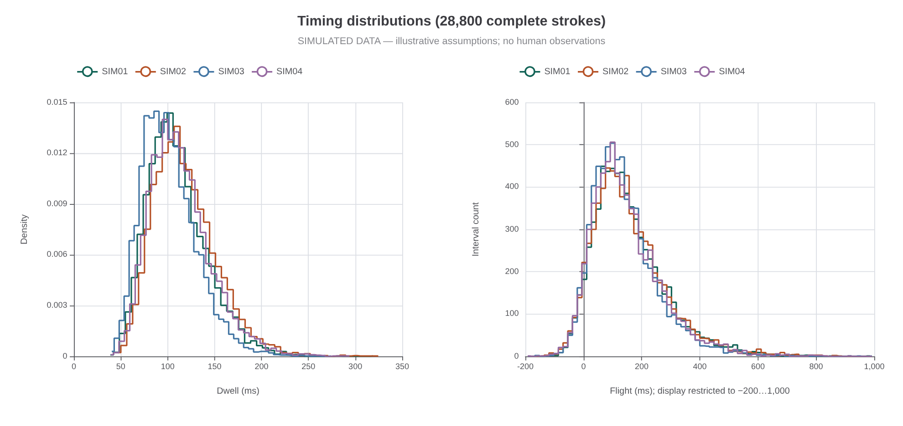
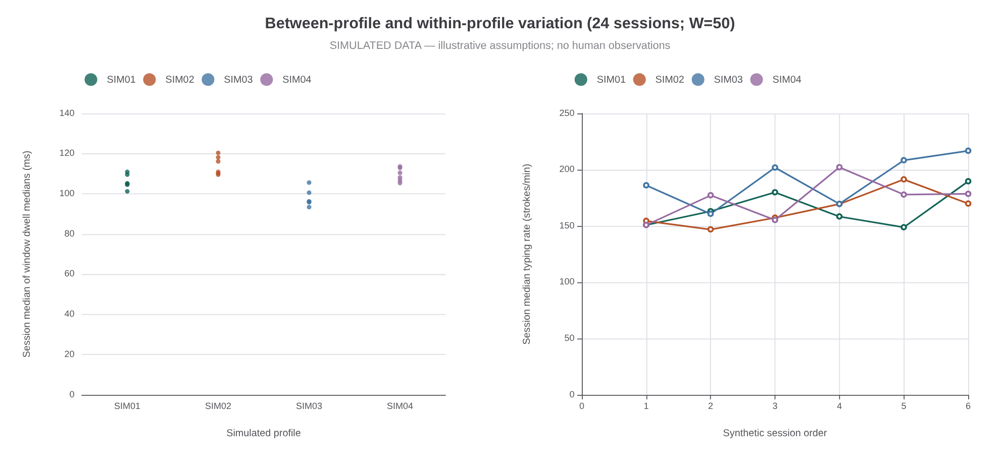
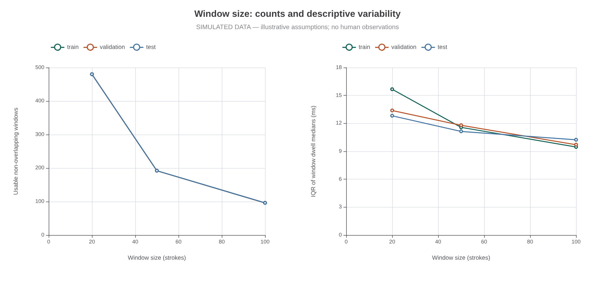
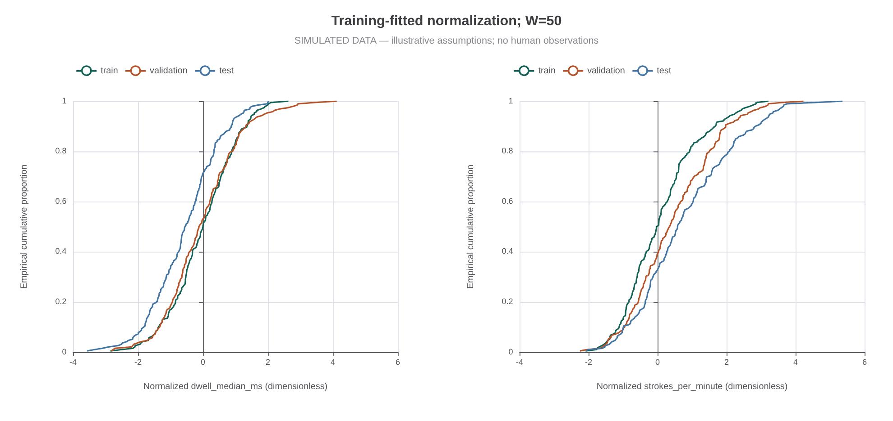
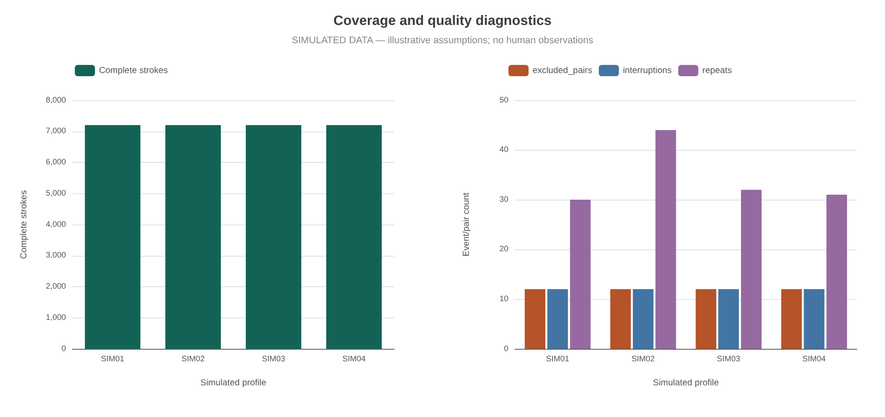

# Báo cáo cuối kỳ — Thành viên 2

## 1. Phạm vi và nguồn dữ liệu

Đề tài: Xác thực liên tục thích ứng dựa trên nhịp gõ phím. Thành viên 2 thực hiện biểu diễn dữ liệu, tiền xử lý, trích xuất đặc trưng, chuẩn hóa và phân tích mô tả.

**Toàn bộ dữ liệu trong báo cáo này là dữ liệu mô phỏng (`data_kind: synthetic`). Không có người tham gia thật, phiếu đồng thuận thật hay quan sát trên thiết bị thật.** Các mã SIM01, SIM02, SIM03, SIM04 là hồ sơ sinh bởi chương trình. Ba ngày là mốc thời gian nghiên cứu tổng hợp, không phải ngày thu thập. Bộ dữ liệu dùng để kiểm tra quy trình xử lý và bàn giao giao diện cho thành viên khác.

## 2. Phương pháp tạo dữ liệu

Lần phân tích này chạy bằng TypeScript/Node.js. Phiên bản trình sinh trong cấu hình dữ liệu: 2.0.0-xoshiro128ss-boxmuller. Giá trị khởi tạo ngẫu nhiên và cấu hình được lưu để tái lập kết quả.

Có 24 phiên và 28,800 lần gõ hoàn chỉnh. Số phiên, đoạn và tham số sinh được ghi trong config.json. Thời gian giữ phím (dwell) và khoảng nhấn–nhấn (down-down) được sinh từ phân phối log-chuẩn; tốc độ có trạng thái AR(1), nhiễu theo phiên và biến động theo ngày. Các hồ sơ có tham số gần nhau, phân phối chồng lấp. Nhóm phím gồm gõ thông thường (`typing`), phân cách (`separator`) và sửa lỗi (`correction`). Một số khoảng nghỉ dài được cộng vào khoảng nhấn–nhấn; sửa lỗi có xu hướng xuất hiện theo cụm.

Thời điểm nhả phím được tính từ thời điểm nhấn cộng thời gian giữ phím, cho phép nhiều phím chồng lấp. Mỗi ranh giới ngắt cố ý có một lần nhấn không có nhả để kiểm tra chất lượng. Sự kiện phím lặp (`repeat`) được ghi dưới dạng chẩn đoán, không trở thành lần gõ mới. Cấu hình số cụ thể và giá trị khởi tạo ngẫu nhiên nằm trong `config.json` và thông tin mô tả từng file. Các tham số chỉ là giả định minh họa; chưa được hiệu chỉnh hoặc kiểm chứng bằng người thật. Không mô phỏng hành vi bộ gõ như bằng chứng thực nghiệm.

## 3. Tiền xử lý và đặc trưng

Quy trình xử lý kiểm tra phiên bản cấu trúc dữ liệu, mã phiên/người, mốc thời gian hữu hạn không âm theo thứ tự và trạng thái start/boundary/resume/stop. Sự kiện được ghép theo pair_id. Cặp thiếu, trùng, sai nhóm hoặc đi qua ranh giới bị loại kèm lý do. Cặp không hợp lệ làm ngắt tính liên tiếp. Khoảng nhả–nhấn (flight) âm được giữ vì có thể xuất hiện khi phím kế tiếp nhấn trước khi phím trước nhả. Khoảng nghỉ dài được giữ trong dữ liệu.

Với lần gõ i: dwell_i = up_i − down_i; flight_i = down_(i+1) − up_i; DD_i = down_(i+1) − down_i. Cửa sổ không chồng lấp gồm 20, 50 hoặc 100 lần gõ và không qua ranh giới đoạn. Mỗi dãy thời gian có trung vị, khoảng tứ phân vị (IQR) và độ lệch tuyệt đối trung vị (MAD). Tốc độ = N × 60000 / (max(up) − min(down)), đơn vị lần gõ/phút. Tỷ lệ nghỉ = số DD > 2000 ms / (N−1). Tỷ lệ sửa = số nhóm correction / N, bao gồm Backspace và Delete. Đây là tốc độ phím vật lý, không phải từ/phút. Không có danh tính phím để xây dựng đặc trưng theo ký tự hoặc digraph.

Ngày tổng hợp 1/2/3 lần lượt là tập huấn luyện/kiểm định/kiểm tra (`train`/`validation`/`test`); toàn bộ cửa sổ của một phiên nằm cùng tập. Với từng hồ sơ và kích thước cửa sổ, ước lượng trung vị và scale = 1.4826 × MAD chỉ trên tập huấn luyện. Giá trị chuẩn hóa = (x−median)/scale. Nếu scale bằng 0, chiều đó được đánh dấu không hoạt động và xuất 0. Có 4 chiều không hoạt động trên tất cả cấu hình. Khi đánh giá mẫu của người khác, phải sử dụng bộ chuẩn hóa của tài khoản được nhận là chủ, không dùng hồ sơ của người cung cấp mẫu. Chuẩn hóa đặc trưng này khác với chuẩn hóa điểm bất thường của thành viên 3.

## 4. Kết quả thực chạy trên dữ liệu mô phỏng

Quy trình xử lý 24 phiên, 28,800 lần gõ hoàn chỉnh và loại 48 cặp. Tổng thời gian ghi mô phỏng là 176.21 phút; thời gian tạm dừng là 45.84 phút. Trong 28,728 khoảng nhả–nhấn trong cùng đoạn, có 1,638 giá trị âm (5.70%). Các con số được tính từ đầu ra hiện tại, không phải mục tiêu đặt trước.

| participant_id | sessions | valid_strokes | excluded_pairs | recording_minutes | interruptions | repeats |
| --- | --- | --- | --- | --- | --- | --- |
| SIM01 | 6 | 7200 | 12 | 45.709 | 12 | 30 |
| SIM02 | 6 | 7200 | 12 | 45.975 | 12 | 44 |
| SIM03 | 6 | 7200 | 12 | 41.428 | 12 | 32 |
| SIM04 | 6 | 7200 | 12 | 43.101 | 12 | 31 |

Tóm tắt đặc trưng theo hồ sơ: tính trung vị từng phiên trước, sau đó trung vị trên các phiên. Không gộp các cửa sổ thành người tham gia độc lập.

| participant_id | dwell_median_ms | flight_median_ms | strokes_per_minute | pause_proportion | correction_proportion |
| --- | --- | --- | --- | --- | --- |
| SIM01 | 105.054 | 142.719 | 160.755 | 0.020 | 0.035 |
| SIM02 | 113.491 | 137.294 | 163.432 | 0.020 | 0.040 |
| SIM03 | 96.148 | 120.070 | 194.006 | 0.020 | 0.040 |
| SIM04 | 109.257 | 124.253 | 177.561 | 0.020 | 0.040 |

Biến động tốc độ giữa ngày tổng hợp 1 và 3, được mô tả sau khi cố định cấu hình:

| participant_id | test | train | validation | test_minus_train_percent |
| --- | --- | --- | --- | --- |
| SIM01 | 169.273 | 157.001 | 169.158 | 7.817 |
| SIM02 | 180.638 | 150.718 | 163.432 | 19.852 |
| SIM03 | 212.580 | 173.433 | 185.730 | 22.572 |
| SIM04 | 178.188 | 164.052 | 178.737 | 8.616 |

Các giá trị test_minus_train_percent có thể âm hoặc dương do nhiễu theo phiên và theo ngày. Đây là biến động được sinh bởi giả định, không phải đo lường độ trôi của người thật. Những khác biệt giữa SIM01–SIM04 không được xem là bằng chứng hiệu quả của mô hình xác thực.

Số cửa sổ và thống kê theo tập:

| window_size | split | windows | sessions | median_dwell_ms | dwell_median_iqr_ms | median_rate |
| --- | --- | --- | --- | --- | --- | --- |
| 20 | test | 480 | 8 | 104.508 | 12.816 | 228.119 |
| 20 | train | 480 | 8 | 108.518 | 15.664 | 196.639 |
| 20 | validation | 480 | 8 | 107.202 | 13.386 | 207.386 |
| 50 | test | 192 | 8 | 105.188 | 11.139 | 182.968 |
| 50 | train | 192 | 8 | 108.806 | 11.572 | 161.480 |
| 50 | validation | 192 | 8 | 108.636 | 11.794 | 174.389 |
| 100 | test | 96 | 8 | 106.039 | 10.236 | 178.141 |
| 100 | train | 96 | 8 | 108.832 | 9.463 | 153.236 |
| 100 | validation | 96 | 8 | 107.561 | 9.710 | 168.737 |

Số đuôi bị bỏ trong lần chạy hiện tại là 0. Khả năng xử lý đuôi ngắn được kiểm thử riêng, không suy ra từ cấu hình thuận lợi này. Các cửa sổ thuộc cùng một phiên hoặc hồ sơ không được xem là những người tham gia độc lập.

## 5. Hình và diễn giải

Hình 1: Phân phối thời gian giữ phím và khoảng nhả–nhấn của các hồ sơ mô phỏng. Trục khoảng nhả–nhấn chỉ hiển thị −200 đến 1000 ms; các khoảng nghỉ ngoài vùng này vẫn tồn tại trong CSV. Các khác biệt phản ánh tham số sinh và nhiễu được cài đặt, không chứng minh khả năng nhận diện người thật.

Hình 2: Mỗi điểm là tóm tắt một phiên với cửa sổ 50 phím; thể hiện biến động trong và giữa hồ sơ tổng hợp.

Hình 3: Cửa sổ lớn tạo ít mẫu hơn. Độ biến động mô tả được xuất trong window_size_summary.csv; không chọn kích thước cửa sổ bằng kết quả trên tập kiểm tra. Mặc định bàn giao là 50 phím.

Hình 4: Phân phối tích lũy của đặc trưng chuẩn hóa. Tập kiểm định/kiểm tra dùng nguyên tham số của tập huấn luyện; không ước lượng lại để ép các tập giống nhau.

Hình 5: Độ bao phủ và chẩn đoán chất lượng. Các cặp thiếu nhả được cố ý sinh để kiểm tra xử lý lỗi.

## 6. Riêng tư, bàn giao và giới hạn

File sự kiện không chứa nội dung gõ hoặc mã phím vật lý. Nhãn `synthetic`, giá trị khởi tạo ngẫu nhiên và cấu hình được giữ xuyên suốt các bảng. Công cụ thu hiện có dành cho thu thật trong tương lai; dữ liệu thật phải có đồng thuận, được lưu riêng ngoài Git, tách bảng ánh xạ danh tính và cho phép rút dữ liệu theo mã phiên. Không trộn dữ liệu mô phỏng (`synthetic`) và dữ liệu thật (`real`) trong cùng một lần chạy.

Bàn giao cho thành viên 1/3: windows.csv, normalized_windows.csv, normalizers.json, manifest.json, từ điển dữ liệu và ví dụ biến đổi theo claimed_profile. Chỉ các cột FEATURE_COLUMNS là đầu vào mô hình; mã, tập dữ liệu, thời gian, nhóm mô phỏng và chẩn đoán không phải đặc trưng nhận diện.

Chưa có dữ liệu người thật, độ trôi thực qua ngày, biến động thiết bị hay bộ gõ thực tế. Nhóm phím, khoảng nghỉ và sửa lỗi chỉ gần đúng bằng giả định. Mô phỏng không sinh nội dung văn bản, không xác nhận tính tự nhiên của chuỗi ký tự và không thể tái hiện toàn bộ hành vi con người. Do đó không báo cáo FAR/FRR/EER/TTD hay khẳng định hiệu quả xác thực thực tế từ công việc này. Muốn đánh giá thực tế cần thu nhiều phiên người thật và kiểm thử độc lập. Đóng góp hoàn thành là quy trình dữ liệu có thể tái lập cùng bộ dữ liệu mô phỏng có nguồn gốc rõ ràng.

## 7. Tái lập và nguồn phương pháp

Chạy theo README của member2. run.json ghi mã băm đầu vào, cấu hình, mã nguồn quy trình xử lý và phiên bản thư viện. Mọi bảng và hình trong báo cáo được sinh tự động từ dữ liệu. Công thức thời gian giữ phím/khoảng nhả–nhấn theo tài liệu phân công và trang trình chiếu số 6 của đề tài; lựa chọn sinh dữ liệu là thiết kế của gói mô phỏng này, không được gán cho một công trình thực nghiệm khác. Kết quả kiểm thử và bản bàn giao được ghi trong VERIFICATION.md sau khi chạy kiểm tra.

Tài liệu tham khảo trực tiếp: Killourhy và Maxion (2009), Comparing Anomaly-Detection Algorithms for Keystroke Dynamics, https://www.cs.cmu.edu/~ksk/KillourhyMaxion2009.pdf; Ayotte và cộng sự (2020), Fast Free-text Authentication via Instance-based Keystroke Dynamics, https://arxiv.org/abs/2006.09337; Dillon và Arushi (2025), An Agent-Based Modeling Approach to Free-Text Keyboard Dynamics for Continuous Authentication, bản thảo arXiv, https://arxiv.org/abs/2505.05015. Ghi chú bài toán, phương pháp, dữ liệu/đánh giá, điểm kế thừa và giới hạn của từng tài liệu nằm trong docs/LITERATURE_REVIEW.md của gói bàn giao. Các công trình này cung cấp bối cảnh thời gian gõ, kích thước mẫu và mô phỏng; không xác nhận tham số sinh hoặc hiệu quả thực tế của bộ SIM01–SIM04.

